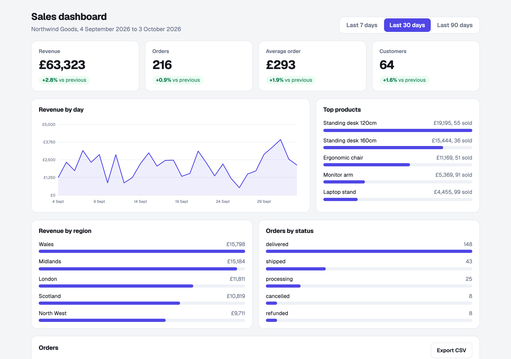
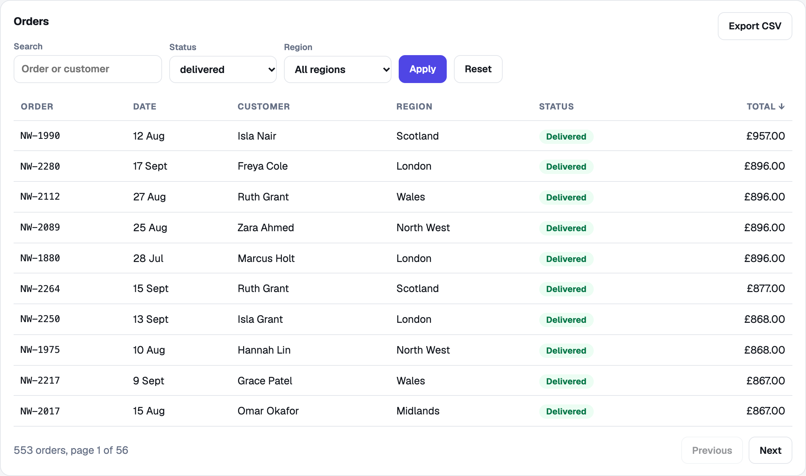

# Sales Dashboard

A business dashboard built with Next.js, TypeScript and no chart library. It shows revenue, orders, average order value and customers for the last 7, 30 or 90 days, each compared with the period before. Below that are a daily revenue chart, top products, revenue by region, orders by status, and a table of orders that can be searched, filtered, sorted and exported to CSV.

The data is generated: a fictional shop called Northwind Goods with 210 days of orders. It is the same every time, so the screenshots and the tests never drift.

## What it looks like



The orders table, filtered to delivered orders and sorted by total:



## What it does

- **Key figures with context.** Each of revenue, orders, average order and customers shows the change against the previous period of the same length. When there is nothing to compare with, it says "n/a" instead of inventing a percentage.
- **One definition of revenue.** Delivered, shipped and processing orders count. Cancelled and refunded orders do not. The footer says so, and every figure uses the same rule.
- **A chart you can hover.** Daily revenue is drawn as plain SVG. Each day shows its figure in a tooltip, and the chart has a text label for screen readers.
- **A table that works without JavaScript.** Search, status and region filters are an ordinary form. Sorting and paging are links. The state lives in the URL, so a filtered view can be bookmarked or shared.
- **CSV export of exactly what you see.** The Export CSV button downloads the current filters and sort, not the whole table. Cells that start with `=`, `+`, `-` or `@` are prefixed so a spreadsheet will not run them as formulas.
- **Safe URLs.** Anything unexpected in the query string (an unknown status, a range of 9999, a page of minus 5, a 500 character search) falls back to a default rather than breaking the page.
- **JSON endpoints** for the same data: `/api/summary`, `/api/orders` and `/api/orders/export`.

## Run it

Built and tested with Node 22, Next.js 16 and React 19.

```bash
npm install
npm run dev          # http://localhost:3000
npm test             # 38 tests
npm run lint
npm run build && npm start
```

## How it is built

```
src/lib/data.ts      the seeded sample data
src/lib/metrics.ts   every calculation: totals, changes, breakdowns, filtering, sorting, paging, CSV
src/lib/query.ts     turns the URL into a safe query, and builds links back
src/components/      small server components: cards, chart, bars, table, filters
src/app/page.tsx     the page, a server component that reads the URL
src/app/api/         the three JSON and CSV endpoints
tests/               vitest
```

All the logic lives in plain functions in `src/lib`, so it is tested without a browser. The page only arranges what those functions return.

## Honest limitations

- **The data is made up.** There is no database and no connection to a real shop. To use real orders, replace `getOrders()` in `src/lib/data.ts` with a query. Everything else keeps working because it only depends on the `Order` shape.
- **No login.** Anyone who can open the page sees the data. Add authentication before pointing it at anything real.
- **The interface itself is not covered by automated tests.** The calculations, URL handling and API routes are (38 tests). I checked the page by hand in a real browser, including filtering and sorting, but there are no component or end to end tests.
- **Dates are whole days in UTC.** An order near midnight in another time zone could land on the neighbouring day.
- **Refunds are all or nothing.** A refunded order is simply excluded. Partial refunds are not modelled.
- **One currency.** Everything is in pounds.
- **The CSV export stops at 5,000 rows.** That is a guard against huge downloads, not a limit of the data.
- **`npm audit` reports 5 high severity findings in development tooling.** They are all in one chain of packages used by the Next.js lint setup (`braces`, through `eslint-config-next`) and none are in the app or its production dependencies, which audit clean. The suggested fix is a downgrade, so I left it.
- **The chart is hand drawn SVG,** which keeps the page small and fast, but it has none of the extras (zoom, brush, legends) that a chart library gives you.
